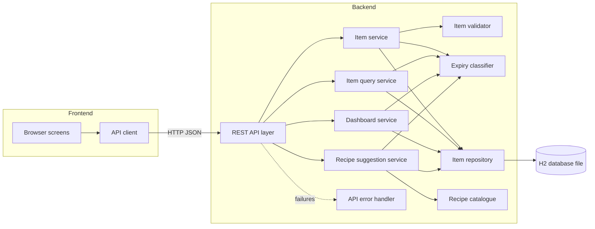

# Architecture: SP-2

Requirements source: requirements.md (revision 2)
Status: draft (revision 2)

## Overview
Smart Pantry Organizer is a single-household web application: a React frontend talks to a Spring Boot REST backend, which stores grocery items in an H2 database in file mode. Expiry status is derived on the backend from the expiry date and today's date, and the dashboard and search/filter views reuse that classification. Recipe suggestions are rule-based over a predefined JSON data file, with no external AI call. No login is provided (Q-017), so the backend binds to localhost by default.

## Components
| Component | Responsibility | Requirements |
|---|---|---|
| Browser screens | Render every user-facing screen (inventory, item forms, detail, dashboard, recipes, search and expiry filter) and forward user actions to the API client. | REQ-001 to REQ-005, REQ-007 to REQ-009, REQ-012 to REQ-027; NFR-001, NFR-002, NFR-010, NFR-011, NFR-015 to NFR-017 |
| API client | Be the single frontend gateway to the backend and map failures to readable messages that include the correlation ID. | REQ-032; NFR-007, NFR-010, NFR-011, NFR-014 |
| REST API layer | Map HTTP endpoints (including the recipe suggestion endpoint) to service calls and service results to HTTP responses. | REQ-001 to REQ-005, REQ-007 to REQ-031; NFR-010, NFR-012, NFR-015 |
| API error handler | Handle failures by returning a sanitized error response and logging the full detail server-side under the same correlation ID. | REQ-028 to REQ-032; NFR-007, NFR-013, NFR-014 |
| Item validator | Decide whether a create or update request for a grocery item is valid. | REQ-001, REQ-004, REQ-007, REQ-009, REQ-028 to REQ-031; NFR-008, NFR-012 |
| Expiry classifier | Derive an item's expiry status and the date bounds of each status from its expiry date and today; an item with no expiry date gets status Valid and no date bound. | REQ-009 to REQ-013, REQ-016, REQ-017, REQ-023, REQ-026; NFR-011 |
| Item service | Manage the lifecycle of a single grocery item (create, read one, update, delete) through the repository. | REQ-001, REQ-003, REQ-004, REQ-005; NFR-005, NFR-008, NFR-010 |
| Item query service | Return active items matching the combined name, category and expiry filters, where no filter returns the full inventory. | REQ-002, REQ-008, REQ-025 to REQ-027; NFR-003, NFR-004, NFR-005 |
| Dashboard service | Compute the dashboard summary from the current inventory on every request. | REQ-014 to REQ-019; NFR-005 |
| Recipe suggestion service | Produce the ranked recipe suggestions from recipe definitions and current pantry item names. | REQ-020, REQ-022 to REQ-024 |
| Recipe catalogue | Provide the predefined recipe definitions, validated and loaded read-only from the shipped data file at startup. | REQ-021, REQ-024 |
| Item repository | Read and write grocery item records through Spring Data JPA. | REQ-006, REQ-020, REQ-025; NFR-003, NFR-004, NFR-006, NFR-010 |
| H2 database | Store grocery item records durably in file mode so they survive restart. | REQ-006; NFR-003, NFR-004, NFR-006 |
| Application shell | Start the backend and serve the built frontend as one runnable application. | NFR-015, NFR-018 |
| Test suites | Verify behaviour with unit, integration, REST, browser and performance tests. | REQ-024, REQ-026; NFR-003 to NFR-005, NFR-019 |

NFR-009 (clean code and naming) applies to every component and is checked in code review.

## Requirement-to-component map
| Requirement | Components |
|---|---|
| REQ-001 | Browser screens, REST API layer, Item validator, Item service |
| REQ-002 | Browser screens, REST API layer, Item query service |
| REQ-003 | Browser screens, REST API layer, Item service |
| REQ-004 | Browser screens, REST API layer, Item validator, Item service |
| REQ-005 | Browser screens, REST API layer, Item service |
| REQ-006 | Item repository, H2 database |
| REQ-007 | Browser screens, REST API layer, Item validator |
| REQ-008 | Browser screens, REST API layer, Item query service |
| REQ-009 | Browser screens, REST API layer, Item validator, Expiry classifier |
| REQ-010 | REST API layer, Expiry classifier |
| REQ-011 | REST API layer, Expiry classifier |
| REQ-012 | Browser screens, Expiry classifier |
| REQ-013 | Browser screens, REST API layer, Expiry classifier |
| REQ-014 | Dashboard service, REST API layer, Browser screens |
| REQ-015 | Dashboard service, REST API layer, Browser screens |
| REQ-016 | Dashboard service, Expiry classifier, REST API layer, Browser screens |
| REQ-017 | Dashboard service, Expiry classifier, REST API layer, Browser screens |
| REQ-018 | Dashboard service, REST API layer, Browser screens |
| REQ-019 | Dashboard service, REST API layer, Browser screens |
| REQ-020 | Recipe suggestion service, Item repository, REST API layer, Browser screens |
| REQ-021 | Recipe catalogue, REST API layer, Browser screens |
| REQ-022 | Recipe suggestion service, REST API layer, Browser screens |
| REQ-023 | Recipe suggestion service, Expiry classifier, REST API layer, Browser screens |
| REQ-024 | Recipe catalogue, Recipe suggestion service, REST API layer, Browser screens, Test suites |
| REQ-025 | Item query service, Item repository, REST API layer, Browser screens |
| REQ-026 | Item query service, Expiry classifier, REST API layer, Browser screens, Test suites |
| REQ-027 | Item query service, REST API layer, Browser screens |
| REQ-028 | Item validator, REST API layer, API error handler |
| REQ-029 | Item validator, REST API layer, API error handler |
| REQ-030 | Item validator, REST API layer, API error handler |
| REQ-031 | Item validator, REST API layer, API error handler |
| REQ-032 | API client, API error handler |
| NFR-001 | Browser screens |
| NFR-002 | Browser screens |
| NFR-003 | Item query service, Item repository, H2 database, Test suites |
| NFR-004 | Item query service, Item repository, H2 database, Test suites |
| NFR-005 | Item service, Item query service, Dashboard service, Test suites |
| NFR-006 | Item repository, H2 database |
| NFR-007 | API error handler, API client |
| NFR-008 | Item validator, Item service |
| NFR-009 | All components |
| NFR-010 | Browser screens, API client (frontend); REST API layer, Item service (backend); Item repository (persistence) |
| NFR-011 | Browser screens, API client, Expiry classifier |
| NFR-012 | Item validator, REST API layer |
| NFR-013 | API error handler |
| NFR-014 | API error handler, API client |
| NFR-015 | REST API layer, Browser screens, Application shell |
| NFR-016 | Browser screens |
| NFR-017 | Browser screens |
| NFR-018 | Application shell |
| NFR-019 | Test suites |

## Technology choices
| Area | Choice | Rationale | Alternatives rejected |
|---|---|---|---|
| Backend language and framework | Java 21, Spring Boot | Section 5 preference; no requirement conflicts with it. | None; preference adopted unchanged. |
| REST APIs | Spring Web MVC REST controllers | Section 5 preference (REST APIs). | GraphQL, gRPC: not in preferences; no requirement needs them. |
| Persistence | Spring Data JPA | Section 5 preference; repository interface keeps persistence separate (NFR-010). | Plain JDBC: more code for the same result. |
| Database | H2, file-based storage, version pinned in the build | Section 5 preference; REQ-006 requires data to survive restart, which file mode provides. | H2 in-memory: loses data on restart, violates REQ-006. Other RDBMS (for example PostgreSQL): not in preferences, would need CP2 approval, no requirement needs it. |
| Frontend | React with Vite; HTML, CSS, JavaScript | Section 5 preference. | Other frontend frameworks: not in preferences. |
| Responsive layout | Plain CSS with breakpoints for 1280px and 375px | Meets NFR-016 and NFR-017 with preferred stack only. | UI component library: adds a dependency not in preferences; not needed for the listed screens. |
| Frontend delivery | Vite build output served as static content by Spring Boot | One runnable application for NFR-018; no cross-origin configuration. | Separate frontend server: extra runtime and CORS configuration with no requirement benefit. |
| Runtime exposure | Bind to localhost by default (bind address configurable); H2 web console disabled outside the development profile | No login (Q-017), so the bind address and console are the only access limits (DR-013). | Bind to all interfaces by default: exposes all data to any reachable client. H2 console enabled in every profile: exposes data without credentials. |
| Server logging | Spring Boot default logging (SLF4J) to standard output | Needed to diagnose failures by correlation ID (DR-011); ships with Spring Boot, no new dependency. | External log service or log shipping: extra infrastructure, no requirement needs it. |
| Recipe data | JSON data file read with Jackson (part of the Spring Boot web starter) | REQ-024 requires a shipped data file with no edit screen or endpoint. | Database table: needs schema and migration for read-only data. Java constant list: mixes data with code. |
| Date and time | java.time with an injected Clock | Standard library; keeps "today" testable (A-005). Time zone pending human decision (DR-006). | Third-party date libraries: not needed. |
| Build | Maven | Section 5 preference. | Gradle: not in preferences. |
| Testing | JUnit, Mockito, REST Assured, Playwright | Section 5 preference; covers NFR-019, the REQ-024 no-AI-call test and the performance test. | Other test frameworks: not in preferences. |
| Coverage measurement (NFR-019) | JaCoCo Maven plugin. Not in preferences; proposed addition, pending human decision at CP2 (DR-015). | NFR-019 requires a measurable backend line coverage figure of at least 80%. | Manual coverage review: not repeatable against the 80% criterion. |
| Version control | Git, GitHub | Section 5 preference; delivery only, no runtime effect. | None. |

No external AI API or paid service is used (REQ-024, BR-8).

## Data flow
1. A user acts in a Browser screen (for example, submits the add form).
2. The API client sends an HTTP JSON request to the REST API layer, which routes writes to the Item service.
3. The Item service calls the Item validator first. If invalid, the API error handler returns a 400 response with readable field messages, and nothing is stored.
4. If valid, the Item service maps the payload to a record and saves it through the Item repository to the H2 database file. An update or delete of a missing item returns 404.
5. For reads, the Item repository loads records; the Expiry classifier adds the status (Expired, Expiring soon, Valid) using today's date; the REST API layer returns the result.
6. The inventory list (REQ-002) is the Item query service with an empty filter. The API client returns the data to the Browser screens, which render lists, detail views, indicators and screens for the dashboard, recipes and search.
7. Search and filter: the Item query service converts the expiry filter into date bounds via the Expiry classifier, applies the name, category and expiry conditions with AND in the repository query, and returns active items only.
8. Dashboard: on each view, the Dashboard service reads the current inventory through the Item repository, classifies it with the Expiry classifier, and returns counts, quantity totals, expiring and expired lists, and category totals.
9. Recipes: the Recipe catalogue provides the validated recipe definitions; the Recipe suggestion service reads pantry item names from the Item repository, flags makeable recipes, computes missing ingredients, ranks the results (Expiring soon use, then fewest missing, then recipe name ascending as the working default pending DR-001), and returns them.
10. Failures: any failure is converted by the API error handler into a sanitized response with a correlation ID and logged server-side; the API client shows a readable message with that ID. A database failure at request time returns a sanitized 503.
11. Startup: the Recipe catalogue validates the data file and the Item repository opens the H2 file. A missing, malformed or empty recipe file, or a locked or corrupt H2 file, stops startup with a logged reason.

## Diagram

## Dispositions (review findings)
| Finding | Disposition | Change made or reason |
|---|---|---|
| DR-001 | deferred (pending human decision) | REQ-023 final tie-break not decided. Working default kept in data flow step 9: recipe name ascending, case-insensitive (Locale.ROOT), so output order is deterministic. Listed under Risks and open questions. |
| DR-002 | accepted | REST API layer added to the map for REQ-001 to REQ-005, REQ-007 to REQ-027 and REQ-028 to REQ-031 (REQ-006 is persistence only). The component responsibility now names the recipe suggestion endpoint. |
| DR-003 | accepted | Browser screens responsibility names the dashboard, recipe and search/expiry-filter screens; these are owned by Browser screens. Map rows for REQ-015 to REQ-018, REQ-020, REQ-022 to REQ-026 now include Browser screens. |
| DR-004 | accepted | (a) REQ-002 is owned by Item query service with an empty filter; Item service reads one item for REQ-003. (b) Test suites added to REQ-024. (c) API error handler added to REQ-028 to REQ-031. |
| DR-005 | accepted | Expiry classifier: an item with no expiry date gets status Valid with no date bound. The Valid filter is expiry date after today plus 3 days and requires a non-null expiry date; it is not "not Expired and not Expiring soon". Test cases for REQ-013 and REQ-026 (null-expiry items excluded from every expiry filter) are assigned to Test suites. |
| DR-006 | deferred (pending human decision) | Time zone for "today" not decided (A-005). Working default kept: server clock through the injected Clock. Listed under Risks and open questions. |
| DR-007 | deferred (pending human decision) | Name normalisation not decided (A-003). Working default kept: case-insensitive exact-name match, no trimming. The proposed rule (trim, collapse internal spaces, case-fold with Locale.ROOT, reject whitespace-only names under REQ-028) is pending. Listed under Risks and open questions. |
| DR-008 | accepted | Q-012 open question removed. Stored items are the active inventory because delete is permanent (REQ-005); "active" wording kept only where the requirements use it. Any future inactive state requires revising the query, dashboard and recipe rules (Risks). |
| DR-009 | accepted | (a) Recipe catalogue validates the file at startup and fails fast with a logged reason on missing, malformed or empty data, so the endpoint never sees an empty catalogue; if no recipe matches, the endpoint returns an empty list. (b) A locked or corrupt H2 file stops startup with a logged reason; a request-time database failure returns a sanitized 503 (REQ-032). |
| DR-010 | accepted | Test suites now includes a performance test: seeded 1,000-item data set, with timed inventory list, search and filter (NFR-003 to NFR-005). The REQ-024 no-network test is assigned to Test suites. |
| DR-011 | accepted | API error handler logs every handled failure server-side with a correlation ID, also returned in the sanitized response and shown by the API client. Logs exclude secrets; no stack trace, SQL or internal detail reaches the client. Destination: backend standard output (Technology choices). |
| DR-012 | accepted | Option 2 chosen: last-write-wins for concurrent edits, recorded as accepted behaviour for a single household. A request that targets a deleted item returns 404 with a readable message. No version field added. Recorded under Risks. |
| DR-013 | accepted | Backend binds to localhost by default with a configurable bind address; H2 web console disabled outside the development profile. Stated in the Runtime exposure row and the Application shell (NFR-015). |
| DR-014 | accepted | Data flow step 3 corrected: the Item service calls the Item validator, matching the diagram. Diagram unchanged. |
| DR-015 | deferred (pending human decision) | JaCoCo not decided at CP2; working default kept (JaCoCo Maven plugin). If CP2 rejects it, no tool in the stack preferences measures line coverage, so NFR-019's 80% criterion cannot be verified until the human chooses another tool or accepts it as unverifiable. |
| DR-016 | accepted | Risks added for file-mode H2: one backend process per database file (a second process fails startup, DR-009); backup by copying the database file while the application is stopped; H2 version pinned in the build. |

## Risks and open questions
- Pending human decision (REQ-023, DR-001): final tie-break for recipes equal on both ranking keys. Default in use: recipe name ascending, case-insensitive.
- Pending human decision (A-005, DR-006): whether "today" is the server clock with a named time zone or the browser date. Default in use: server clock; no zone chosen yet. Near midnight the two can differ.
- Pending human decision (A-003, DR-007): name normalisation beyond case-insensitive comparison. Default in use: case-insensitive exact-name match, no trimming. Recipe ingredient quantities are not compared (A-003).
- Pending human decision (CP2, DR-015): JaCoCo is a technology addition outside the Section 5 preferences, proposed for NFR-019 coverage measurement.
- Risk: the recipe catalogue content (about 10 recipes, REQ-024) is not in the story. The data file must be authored as a delivery item.
- Risk: NFR-003 and NFR-004 (1 second at 1,000 items) depend on file-mode H2 and on per-request classification. No caching is designed; the performance test (Test suites) must confirm this.
- Risk: no authentication (NFR-015, Q-017). Any reachable client can read and change data. Accepted for a single-household deployment; localhost binding by default limits exposure.
- Risk: H2 file mode (DR-016). Single-process file locking, backup and recovery, and a pinned version are the mitigations above.
- Risk: last-write-wins for concurrent edits (DR-012). Two tabs can overwrite each other silently; accepted for a single household.
- Risk: any future inactive or soft-delete state (DR-008) would require revising the query, dashboard and recipe rules.

## Revision log
| Rev | Date (UTC) | Trigger | Agent | Summary |
|---|---|---|---|---|
| 1 | 2026-11-25T00:00Z | initial | architect | Initial architecture from requirements rev 2: 15 components, all 32 REQ and 19 NFR IDs mapped, Section 5 stack adopted with one proposed addition (JaCoCo) for CP2 approval, Mermaid diagram, 4 requirement open questions. |
| 2 | 2026-11-25T00:00Z | design review round 1 | architect | Responded to DR-001 to DR-016: 12 accepted (API layer and screen owners added to the map, null-expiry rule, startup and DB failure handling, performance and no-network tests, logging with correlation ID, localhost binding, H2 risks, step 3 fixed); 4 deferred pending human decision (DR-001 REQ-023 tie-break, DR-006 and DR-007 for A-005 and A-003, DR-015 JaCoCo); 0 rejected. Q-012 question removed. Stack unchanged. |
