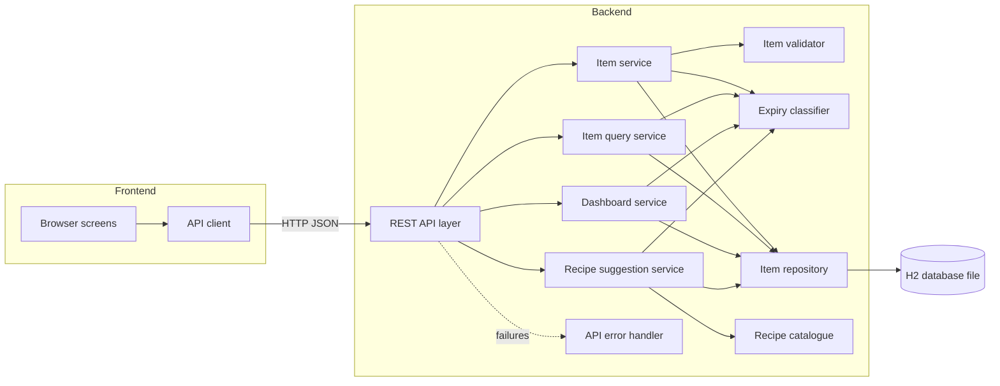

# Architecture: SP-2

Requirements source: requirements.md (revision 2)
Status: draft (revision 1)

## Overview
Smart Pantry Organizer is a single-household web application: a React frontend talks to a Spring Boot REST backend, which stores grocery items in an H2 database in file mode. Expiry status is derived on the backend from the expiry date and today's date, and the dashboard and search/filter views reuse that classification. Recipe suggestions are rule-based over a predefined JSON data file, with no external AI call. No login is provided (Q-017).

## Components
| Component | Responsibility | Requirements |
|---|---|---|
| Browser screens | Render the pantry screens and forward user actions to the API client. | REQ-001 to REQ-005, REQ-007 to REQ-009, REQ-012 to REQ-014, REQ-019, REQ-021, REQ-027; NFR-001, NFR-002, NFR-010, NFR-011, NFR-015 to NFR-017 |
| API client | Be the single frontend gateway to the backend and map failures to readable messages. | REQ-032; NFR-007, NFR-010, NFR-011, NFR-014 |
| REST API layer | Map HTTP endpoints to service calls and service results to HTTP responses. | REQ-028 to REQ-031; NFR-010, NFR-012, NFR-015 |
| API error handler | Convert any failure into a sanitized error response with no stack trace or internal detail. | REQ-032; NFR-007, NFR-013, NFR-014 |
| Item validator | Decide whether a create or update request for a grocery item is valid. | REQ-001, REQ-004, REQ-007, REQ-009, REQ-028 to REQ-031; NFR-008, NFR-012 |
| Expiry classifier | Derive an item's expiry status and the date bounds of each status from the expiry date and today. | REQ-009 to REQ-013, REQ-016, REQ-017, REQ-023, REQ-026; NFR-011 |
| Item service | Manage the lifecycle of grocery items (create, read, update, delete) through the repository. | REQ-001 to REQ-005; NFR-003, NFR-005, NFR-008, NFR-010 |
| Item query service | Return active items that match the combined name, category and expiry filters. | REQ-008, REQ-025 to REQ-027; NFR-004, NFR-005 |
| Dashboard service | Compute the dashboard summary from the current active inventory on every request. | REQ-014 to REQ-019; NFR-005 |
| Recipe suggestion service | Produce the ranked recipe suggestions from recipe definitions and current pantry item names. | REQ-020, REQ-022 to REQ-024 |
| Recipe catalogue | Provide the predefined recipe definitions loaded read-only from the shipped data file. | REQ-021, REQ-024 |
| Item repository | Read and write grocery item records through Spring Data JPA. | REQ-006, REQ-020, REQ-025; NFR-003, NFR-004, NFR-006, NFR-010 |
| H2 database | Store grocery item records durably in file mode so they survive restart. | REQ-006; NFR-003, NFR-004, NFR-006 |
| Application shell | Start the backend and serve the built frontend as one runnable application. | NFR-018 |
| Test suites | Verify behaviour with unit, integration, REST and browser tests. | NFR-019 |

NFR-009 (clean code and naming) applies to every component and is checked in code review.

## Requirement-to-component map
| Requirement | Components |
|---|---|
| REQ-001 | Browser screens, Item validator, Item service |
| REQ-002 | Browser screens, Item service |
| REQ-003 | Browser screens, Item service |
| REQ-004 | Browser screens, Item validator, Item service |
| REQ-005 | Browser screens, Item service |
| REQ-006 | Item repository, H2 database |
| REQ-007 | Browser screens, Item validator |
| REQ-008 | Browser screens, Item query service |
| REQ-009 | Browser screens, Item validator, Expiry classifier |
| REQ-010 | Expiry classifier |
| REQ-011 | Expiry classifier |
| REQ-012 | Browser screens, Expiry classifier |
| REQ-013 | Browser screens, Expiry classifier |
| REQ-014 | Dashboard service, Browser screens |
| REQ-015 | Dashboard service |
| REQ-016 | Dashboard service, Expiry classifier |
| REQ-017 | Dashboard service, Expiry classifier |
| REQ-018 | Dashboard service |
| REQ-019 | Dashboard service, Browser screens |
| REQ-020 | Recipe suggestion service, Item repository |
| REQ-021 | Recipe catalogue, Browser screens |
| REQ-022 | Recipe suggestion service |
| REQ-023 | Recipe suggestion service, Expiry classifier |
| REQ-024 | Recipe catalogue, Recipe suggestion service |
| REQ-025 | Item query service, Item repository |
| REQ-026 | Item query service, Expiry classifier |
| REQ-027 | Item query service, Browser screens |
| REQ-028 | Item validator, REST API layer |
| REQ-029 | Item validator, REST API layer |
| REQ-030 | Item validator, REST API layer |
| REQ-031 | Item validator, REST API layer |
| REQ-032 | API client, API error handler |
| NFR-001 | Browser screens |
| NFR-002 | Browser screens |
| NFR-003 | Item service, Item repository, H2 database |
| NFR-004 | Item query service, Item repository, H2 database |
| NFR-005 | Item service, Item query service, Dashboard service |
| NFR-006 | Item repository, H2 database |
| NFR-007 | API error handler, API client |
| NFR-008 | Item validator, Item service |
| NFR-009 | All components |
| NFR-010 | Browser screens, API client (frontend); REST API layer, Item service (backend); Item repository (persistence) |
| NFR-011 | Browser screens, API client, Expiry classifier |
| NFR-012 | Item validator, REST API layer |
| NFR-013 | API error handler |
| NFR-014 | API error handler, API client |
| NFR-015 | REST API layer, Browser screens |
| NFR-016 | Browser screens |
| NFR-017 | Browser screens |
| NFR-018 | Application shell |
| NFR-019 | Test suites |

## Technology choices
| Area | Choice | Rationale | Alternatives rejected |
|---|---|---|---|
| Backend language and framework | Java 21, Spring Boot | Section 5 preference; no requirement conflicts with it. | None; preference adopted unchanged. |
| REST APIs | Spring Web MVC REST controllers | Section 5 preference (REST APIs). | GraphQL, gRPC: not in preferences; no requirement needs them. |
| Persistence | Spring Data JPA | Section 5 preference; repository interface keeps persistence separate (NFR-010). | Plain JDBC: more code for the same result. |
| Database | H2, file-based storage | Section 5 preference; REQ-006 requires data to survive restart, which file mode provides. | H2 in-memory: loses data on restart, violates REQ-006. Other RDBMS (for example PostgreSQL): not in preferences, would need CP2 approval, no requirement needs it. |
| Frontend | React with Vite; HTML, CSS, JavaScript | Section 5 preference. | Other frontend frameworks: not in preferences. |
| Responsive layout | Plain CSS with breakpoints for 1280px and 375px | Meets NFR-016 and NFR-017 with preferred stack only. | UI component library: adds a dependency not in preferences; not needed for the listed screens. |
| Frontend delivery | Vite build output served as static content by Spring Boot | One runnable application for NFR-018; no cross-origin configuration. | Separate frontend server: extra runtime and CORS configuration with no requirement benefit. |
| Recipe data | JSON data file read with Jackson (part of the Spring Boot web starter) | REQ-024 requires a shipped data file with no edit screen or endpoint. | Database table: needs schema and migration for read-only data. Java constant list: mixes data with code. |
| Date and time | java.time with an injected Clock | Standard library; keeps "today" testable (A-005). | Third-party date libraries: not needed. |
| Build | Maven | Section 5 preference. | Gradle: not in preferences. |
| Testing | JUnit, Mockito, REST Assured, Playwright | Section 5 preference; covers NFR-019 and REQ-024 no-AI-call test. | Other test frameworks: not in preferences. |
| Coverage measurement (NFR-019) | JaCoCo Maven plugin. Not in preferences; proposed addition, subject to CP2 approval. | NFR-019 requires a measurable backend line coverage figure of at least 80%. | Manual coverage review: not repeatable against the 80% criterion. |
| Version control | Git, GitHub | Section 5 preference; delivery only, no runtime effect. | None. |

No external AI API or paid service is used (REQ-024, BR-8).

## Data flow
1. A user acts in a Browser screen (for example, submits the add form).
2. The API client sends an HTTP JSON request to the REST API layer.
3. The REST API layer passes the payload to the Item validator. If invalid, the API error handler returns a 400 response with readable field messages, and nothing is stored.
4. If valid, the Item service maps the payload to a record and saves it through the Item repository to the H2 database file.
5. For reads, the Item repository loads records; the Expiry classifier adds the status (Expired, Expiring soon, Valid) using today's date; the REST API layer returns the result.
6. The API client returns the data to the Browser screens, which render lists, detail views and indicators.
7. Search and filter: the Item query service converts the expiry filter into date bounds via the Expiry classifier, applies the name, category and expiry conditions with AND in the repository query, and returns active items only.
8. Dashboard: on each view, the Dashboard service reads current active items through the Item repository, classifies them with the Expiry classifier, and returns counts, quantity totals, expiring and expired lists, and category totals.
9. Recipes: the Recipe catalogue loads the JSON data file; the Recipe suggestion service reads active pantry item names from the Item repository, flags makeable recipes, computes missing ingredients, ranks the results, and returns them.
10. Any failure at any step is converted by the API error handler (backend) or the API client (frontend) into a readable message with no internal detail.

## Diagram

## Dispositions (review findings)
| Finding | Disposition | Change made or reason |
|---|---|---|

No review findings yet.

## Risks and open questions
- Open question (requirements): "active" items are referred to throughout, but delete is permanent (Q-012) and no inactive state exists. This design treats every stored item as active. Please confirm.
- Open question (requirements): REQ-023 defines two ranking keys. No final tie-break is specified. The design does not choose one until requirements decide it.
- Open question (requirements): A-005 does not say whether "today" is the server clock or the user's browser date. This design uses the server clock. Near midnight the two can differ.
- Open question (requirements): A-003 ignores recipe ingredient quantities. Name normalisation beyond case-insensitive comparison (for example surrounding spaces) is not defined. The design matches names only.
- Approval needed (CP2): JaCoCo is a technology addition outside the Section 5 preferences, proposed for NFR-019 coverage measurement.
- Risk: the recipe catalogue content (about 10 recipes, REQ-024) is not in the story. The data file must be authored as a delivery item.
- Risk: NFR-003 and NFR-004 (1 second at 1,000 items) depend on file-mode H2 and on per-request classification. No caching is designed; the performance test must confirm this.
- Risk: no authentication (NFR-015, Q-017). Any reachable client can read and change data. This is accepted for a single-household local deployment.

## Revision log
| Rev | Date (UTC) | Trigger | Agent | Summary |
|---|---|---|---|---|
| 1 | 2026-11-25T00:00Z | initial | architect | Initial architecture from requirements rev 2: 15 components, all 32 REQ and 19 NFR IDs mapped, Section 5 stack adopted with one proposed addition (JaCoCo) for CP2 approval, Mermaid diagram, 4 requirement open questions. |
